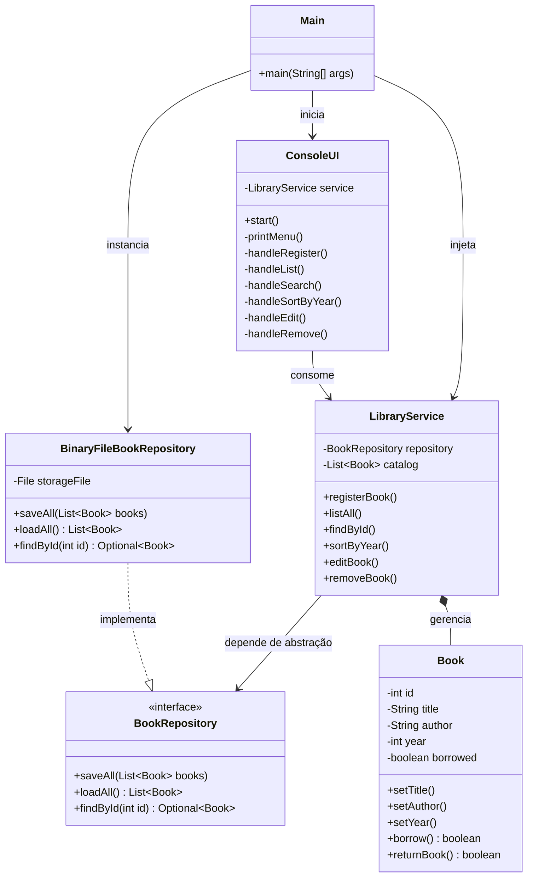

# 📚 Sistema de Biblioteca — Arquitetura POO (Java)

Evolução arquitetural do sistema de gestão de acervo bibliotecário, migrando do paradigma **Procedural em C** (`structs` e manipulação direta de binários) para **Programação Orientada a Objetos em Java** aplicando princípios **SOLID** e separação em camadas.

## 🏗️ Arquitetura do Sistema

O projeto utiliza arquitetura em camadas com Inversão de Dependência (DIP), isolando as regras de negócio da tecnologia de persistência e da interface de console:



## 🖥️ Interface de Console

O menu atual aceita as seguintes operações:

1. Cadastrar livros
2. Imprimir todos os livros
3. Pesquisar livro por código
4. Ordenar livros por ano de publicação
5. Editar livro por código
6. Remover livro por código
7. Sair do programa

Os livros são exibidos com código, título, autor, ano de publicação e status. Após cada operação, a interface aguarda `ENTER` antes de retornar ao menu.

## 🚀 Como Executar

### Windows (PowerShell)
```powershell
.\build.ps1
```

### Linux / macOS / Git Bash
```bash
chmod +x build.sh
./build.sh
```

## 🛠️ Decisões Técnicas (Clean Code & SOLID)
- **Single Responsibility Principle (SRP):** Entidade (`Book`), regra de negócio (`LibraryService`), persistência (`BinaryFileBookRepository`) e apresentação (`ConsoleUI`) possuem responsabilidades únicas e isoladas.
- **Dependency Inversion Principle (DIP):** O serviço de domínio depende exclusivamente do contrato `BookRepository`, permitindo substituir `acervo.dat` por bancos SQL/NoSQL sem alterar regras de negócio.
- **CI/CD Integrado:** Pipeline no GitHub Actions validando a compilação com JDK 21 a cada Push ou Pull Request.